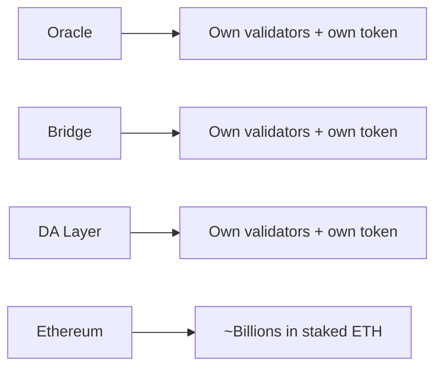

> **Series:** EigenLayer Deep Dive | **Episode:** 1 | **Level:** Beginner
> **Source material:** EigenLayer Whitepaper, Section 1 (Introduction)

## TL;DR

(Two or three sentences: what problem does this episode explain, and what should the reader walk away knowing?)

## Background: What "security" means for a blockchain

(Explain briefly: validators, staking, economic security, and why attacking a chain should cost more than it earns.)

## The Problem

(Explain fragmented security: every new protocol, such as an oracle, a bridge, or a data availability layer, must bootstrap its own validator set and its own token for security.)

## Why this is a real cost

- Capital is split across many small security pools
- New protocols start weak and are easy to attack
- Builders spend time on security instead of their product

## The idea EigenLayer proposes

(One short paragraph: reuse already-staked ETH to secure other services. Details come in the next episodes.)

## Key Takeaways

- ...
- ...
- ...

## Review Questions

1. ...
2. ...
3. ...

## Next Episode

EigenLayer Deep Dive #2: (title)
